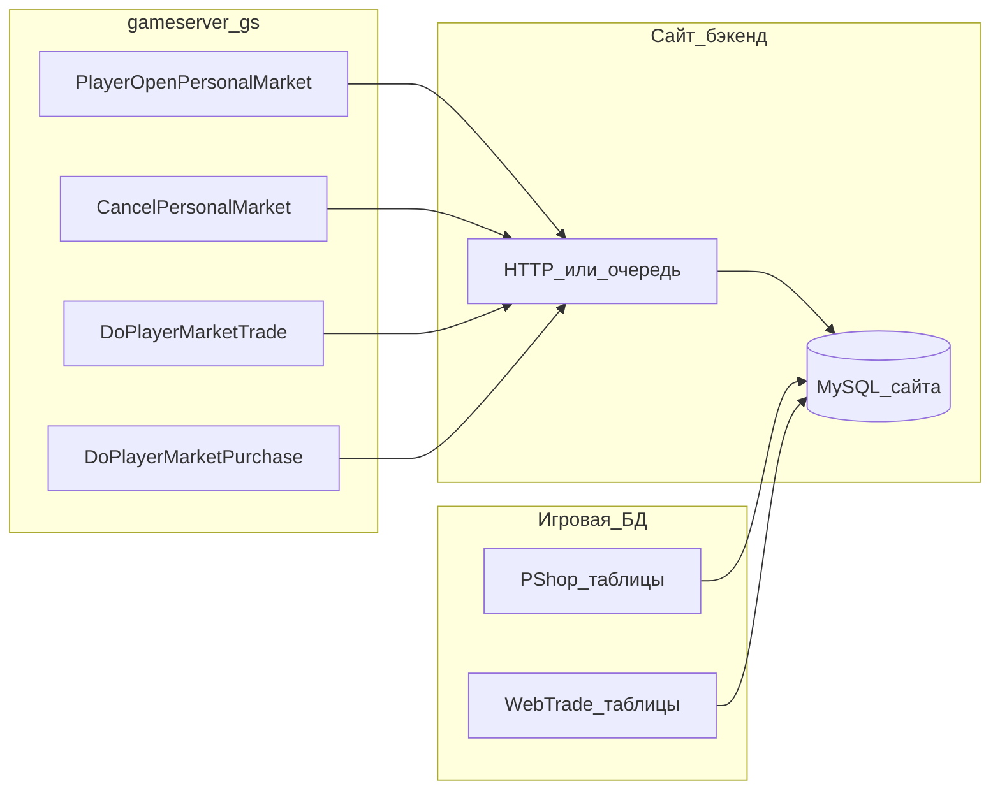

# Синхронизация лавок и комиссионки с БД для сайта

## Требования к отображению (уточнение по референсу)

**Комиссионный магазин** — это **категория источника**, а не точка на карте. **Координат нет**; в колонке «Координаты» (как на примерах с другого проекта) достаточно вывести строку вроде **«Комиссионный магазин»** и не пытаться хранить X/Y/world tag для PShop.

**Торговый кот** — физическая лавка в мире: нужны **координаты** (например `528 665`) и **локация** (название/ID мира, world tag), как в клиентском окне «Лавка».

**Веб-аукцион** (если используете) — отдельная строка в таблице поиска: например **«Аукцион лот № …»**, без координат.

Итого в БД/ API удобно завести поле `**listing_source`** (или аналог): `cat` | `commission` | `auction` — и на фронте по нему строить колонку координат: числа только для `cat`, текстовая метка для остальных.

---

## Что уже есть в коде

### 1. Личный рынок / «кот» (摆摊, personal market)

Реализован на **gameserver** в `[serverdeiban12/cgame/gs/playerstall.cpp](C:\pw152\client152\155EVLVD\serverdeiban12\cgame\gs\playerstall.cpp)`:

- Открытие лавки: `gplayer_imp::PlayerOpenPersonalMarket` — создаётся `player_stall`, заполняется имя, слоты, список товаров (тип предмета, количество, цена; продажа vs скупка различается по `index == 0xFFFF` в `[playerstall.h](C:\pw152\client152\155EVLVD\serverdeiban12\cgame\gs\playerstall.h)`).
- Закрытие: `CancelPersonalMarket` — уничтожается `_stall_obj`.
- Покупка у лавки: `DoPlayerMarketTrade` — уменьшается `ent.count`, при нуле вызывается `DecSellSlot`.
- Продажа лавке (скупка): `DoPlayerMarketPurchase` — аналогично для ордеров.

Нужные для сайта поля **уже доступны в этих точках**:

- Название магазина: `_stall_obj->GetName()` / длина `GetNameLen()`.
- Кто торговец: `GetParent()->ID.id` (role id).
- Предметы, количество, цена: цикл по `_stall_obj->_goods_list`.
- Координаты: позиция игрока `((gplayer *)_parent)->pos` (тип `A3DVECTOR`).
- ID локации (world tag): `world_manager::GetWorldTag()` (см. также `[msgio.cpp](C:\pw152\client152\155EVLVD\serverdeiban12\cgame\gs\io\msgio.cpp)`).

Отдельной «таблицы открытых лавок» в типичной связке PW **нет**: пока лавка открыта, состояние в памяти GS. Полное состояние для сайта нужно **явно выталкивать** наружу.

### 2. Комиссионный магазин (PShop)

На **gdeliveryd** есть `[PShopMarket](C:\pw152\client152\155EVLVD\serverdeiban12\cnet\gdeliveryd\pshopmarket.h)` / `[pshopmarket.cpp](C:\pw152\client152\155EVLVD\serverdeiban12\cnet\gdeliveryd\pshopmarket.cpp)`: магазины загружаются из БД (`LoadFromDB`, `dbpshopload`), списки покупки/продажи и склад в `[pshopdetail](C:\pw152\client152\155EVLVD\serverdeiban12\cnet\rpcdata\pshopdetail)` (`roleid`, `blist`, `slist`, `store`, цены в `PShopItem`).

Для сайта **не нужны** координаты: достаточно **roleid**, списков предметов/цен, **ника** (join по таблице ролей в gamedbd) и флага `**listing_source = commission`**. Название «магазина» в клиенте может совпадать с ником или браться из кастомной логики — **не вводит координат**.

### 3. Веб-торговля (аукцион)

`[WebTradeMarket](C:\pw152\client152\155EVLVD\serverdeiban12\cnet\gdeliveryd\webtrademarket.h)` синхронизируется с gamedbd через `dbwebtrade*.hrp`. Для строки поиска по предмету — **номер лота (sn)** и пометка аукциона; координат нет.

---

## Возможно ли «моментально в базе»

| Источник            | Моментальность                   | Комментарий                                                  |
| ------------------- | -------------------------------- | ------------------------------------------------------------ |
| Кот                 | Да, при хуках в GS               | `DoPlayerMarketTrade` / `CancelPersonalMarket` / очередь     |
| PShop (комиссионка) | Да, при обновлениях в игровой БД | Репликация/триггеры/чтение gamedbd; **координаты не храним** |
| Аукцион             | Да                               | Уже в БД; показ «лот № …»                                    |

В штатном **gameserver** прямого MySQL для лавок нет — варианты: **HTTP/gRPC** в бэкенд сайта, очередь, или расширение RPC.

---

## Рекомендуемая архитектура (высокоуровнево)

- **Коты:** поток только из GS → ваша БД.
- **Комиссионка и аукцион:** импорт/реплика из **игровой БД** (или события из gdeliveryd), без полей координат в модели.

---

## Сервер или клиент игры

Для задачи «писать в БД сайта и показывать на сайте» **игровой клиент (ElementClient) править не обязательно**.

- **Торговый кот:** источник правды — **gameserver** (`playerstall.cpp` и связанная логика). Клиент уже открывает лавку и ходит по тем же протоколам; экспорт наружу делается **только на GS** (хуки при открытии/закрытии/сделках).
- **Комиссионка (PShop):** данные живут в цепочке **gdeliveryd / gamedbd**; достаточно **серверной** стороны (реплика/импорт в БД сайта или хуки на delivery). Клиент не участвует.
- **Веб-аукцион:** уже в **игровой БД**; сайт читает её или ваш бэкенд — клиент не трогаем.

**Клиент понадобится** только если вы хотите что-то **внутри игры** (новое окно, другой протокол, отправка данных с клиента на сайт). Для отслеживания с **сайта** это **не рекомендуется** и не нужно: клиент можно подделать, а сервер — единственный надёжный источник.

Отдельно от игрового клиента — **сайт** (свой фронт/бэкенд): его вы делаете сами, это не патч PW-клиента.

---

## Риски и уточнения

1. **Offline market** (`[OFFLINE_MARKET_ITEM_ID](C:\pw152\client152\155EVLVD\serverdeiban12\cgame\gs\config.h)`): при дисконнекте убедиться, что событие закрытия лавки попадает в экспорт.
2. Нагрузка: **delta** или debounce для полных снимков лавки при частых сделках.
3. Единый **поиск по предмету** на сайте: объединять три источника (кот / PShop / аукцион) с разными правилами колонки «Координаты».

---

## Итог

- **Торговый кот:** координаты + world tag + имя лавки + товары — **из GS** через хуки экспорта.
- **Комиссионка:** только **категория и товары** (из PShop/gamedbd); **координаты не нужны** — в UI фиксированный текст.
- **Аукцион:** лот и данные из существующей веб-торговой БД; координат нет.

